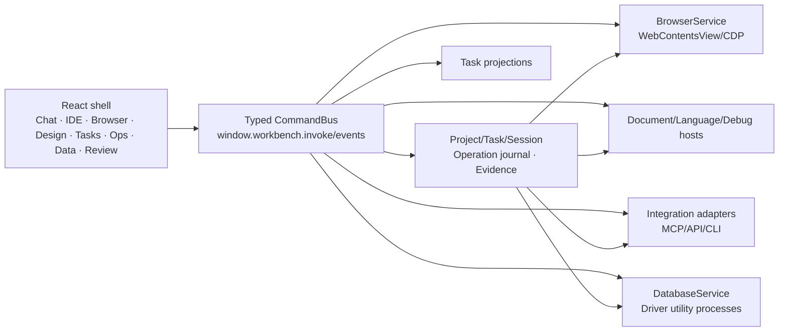

# Полное рабочее пространство: карта реализации

Этот пакет описывает целевую реализацию расширенного GigaCode Workbench и автономный перенос уже существующего кода на рабочем компьютере. Он не утверждает, что перечисленные функции уже находятся в runtime текущего `app/`.

Главная точка входа для агента — [`SUITE-UPGRADE-AGENT.md`](../../SUITE-UPGRADE-AGENT.md). Интерактивный визуальный контракт — [`design/suite-workspace-prototype.html`](../../design/suite-workspace-prototype.html). 14.10.2026 пользователь разрешил реализацию и любые улучшения UI/UX: [`implementation_authorized_by_user`](PROTOTYPE-REVIEW-GATE.md). Рабочая IDE описана в [IDE-RUNTIME-HANDOFF](IDE-RUNTIME-HANDOFF.md). Машиночитаемые карточки — [`suite/implementation-plan.json`](../../suite/implementation-plan.json).

## Документы

| Документ | Что определяет |
| --- | --- |
| [UX-FOUNDATION](UX-FOUNDATION.md) | Единый shell, навигацию, размеры, состояния, accessibility и UX gates |
| [BROWSER](BROWSER.md) | Browser Lab, автоматизацию, identity/certificates, DevTools и evidence |
| [DESIGN-AND-ARTIFACTS](DESIGN-AND-ARTIFACTS.md) | Сбор интерактивных макетов, версии, количественный audit, handoff и проверку реализации |
| [DESIGN-SYSTEM-AND-UI-KIT](DESIGN-SYSTEM-AND-UI-KIT.md) | Корпоративные DTCG tokens, component/state catalog, оригинальные icons/templates, repository governance, releases и consumer updates |
| [PROTOTYPE-REVIEW-GATE](PROTOTYPE-REVIEW-GATE.md) | Визуальный review и актуальное прямое разрешение реализации от 14.10.2026 |
| [IDE](IDE.md) | Выбор IDE engine, единые buffers, LSP/DAP, run/test и Java/Python/React |
| [IDE-ULTIMATE-RESEARCH](IDE-ULTIMATE-RESEARCH.md) | Сравнение IDEA/IntelliJ Platform, Code-OSS, Theia и Monaco; лицензии, gaps и этапы |
| [IDE-ULTIMATE-PARITY](IDE-ULTIMATE-PARITY.md) | 151 адресных IDE capabilities с реализацией, ограничениями и проверяемой приёмкой |
| [TASK-TRACKER](TASK-TRACKER.md) | Task aggregate, list/board/timeline, требования, связи и историю |
| [OPERATIONS](OPERATIONS.md) | OpenShift/Kubernetes, Jenkins, knowledge и MCP adapters |
| [DATABASE-RUNTIME-HANDOFF](DATABASE-RUNTIME-HANDOFF.md) | Рабочий PostgreSQL/MCP runtime, UI, Windows перенос, проверки и открытые gaps |
| [DATABASE](DATABASE.md) | Connection vault, schema, SQL, grid, transactions, explain и diagrams |
| [DEPENDENCY-SECURITY](DEPENDENCY-SECURITY.md) | Sprut, уязвимые версии библиотек, baseline, upgrade proposal и verification |
| [SOURCE-CONTROL](SOURCE-CONTROL.md) | Git, изменения агента, clone/push и корпоративные pull requests/review |
| [CONNECTIONS-AND-SETTINGS](CONNECTIONS-AND-SETTINGS.md) | Несколько MCP/endpoints, credentials, scopes и явная настройка |
| [LIFECYCLE-AND-SETTINGS](LIFECYCLE-AND-SETTINGS.md) | CRUD/archive, полную IA настроек, окна, docking и diagnostic bundles |
| [AGENT-RUNTIME-AND-ROLES](AGENT-RUNTIME-AND-ROLES.md) | Prompt layers, роли, SDD, queue/questions, контекст, память, retries и subagents |
| [DEVELOPER-WORKFLOW](DEVELOPER-WORKFLOW.md) | Project bindings, бесшовное переключение и эффективный сквозной процесс |
| [ADAPTER-CONTRACTS](ADAPTER-CONTRACTS.md) | Общий command/capability/operation protocol |
| [DELIVERY-PLAN](DELIVERY-PLAN.md) | Порядок вертикальных срезов и перенос существующих модулей |
| [ACCEPTANCE](ACCEPTANCE.md) | Проверяемые критерии и сквозные сценарии |
| [COMPETITOR-CAPABILITY-MATRIX](COMPETITOR-CAPABILITY-MATRIX.md) | Максимальную карту переносимых функций агентских, IDE, design, tracker, database и DevOps-сред |
| [COMPETITOR-GAP-AUDIT](COMPETITOR-GAP-AUDIT.md) | Сравнение с выбранными конкурентами, runtime evidence, решения adopt/adapt/defer/reject и незакрытые gaps |
| [OPEN-SOURCE](OPEN-SOURCE.md) | Разрешённые кандидаты, границы лицензий и что нельзя копировать |

## Общая архитектура

Renderer не содержит credentials, database drivers, cluster clients или language processes. `WorkbenchService` остаётся владельцем Project/Task/Session и persisted operation metadata. Большие/потоковые данные не проходят через полный `state.get`: browser events, logs, terminal data, query pages, LSP и debug events адресуются по resource ID.

## Целевая модель интерфейса

У пользователя один shell:

- слева activity rail с рабочими пространствами;
- рядом контекстный navigator текущей области;
- в центре вкладки документов/страниц/консолей;
- справа скрываемый inspector выбранного объекта;
- снизу скрываемые output/terminal/problems/results;
- сверху project/task breadcrumb, command palette и фактический target;
- в чате компактные карточки tool/operation с переходом к результату.

Browser, Design, IDE, Tasks, Operations, Data и Review не становятся отдельными приложениями внутри приложения. Общие вкладки, docking, поиск, selection, settings, history, notifications, permissions и keyboard model реализуются один раз.

Design дополнительно содержит `Canvas · UI Kit · Publish` внутри одного workspace. Reference source starter хранится в [`ui-kit/`](../../ui-kit/README.md), может быть перенесён в отдельный корпоративный Git/Bitbucket-совместимый repository и честно отделяет specification/reference source от candidate/stable. Публикация использует review, SemVer/channels, SBOM/signing/provenance и consumer compatibility; пакет не содержит чужих/Sber/vendor assets.

## Что считается полной реализацией

Полнота означает покрытие capability matrix и сквозных сценариев, а не визуальное сходство с конкретным коммерческим продуктом. Названия Jira и DataGrip используются только как понятное описание класса функций. Нельзя копировать их код, ресурсы, тексты, иконки или фирменный внешний вид.

Каждая capability имеет четыре состояния:

1. `unavailable` — adapter/окружение отсутствует, причина и настройка видимы;
2. `available` — capability обнаружена и schema проверена;
3. `working` — реализован вызываемый путь;
4. `verified` — сохранено evidence конкретной целевой среды.

Только `verified` можно описывать пользователю как проверенную функцию. Пакет намеренно отделяет целевую реализацию от текущего статуса исходников.
