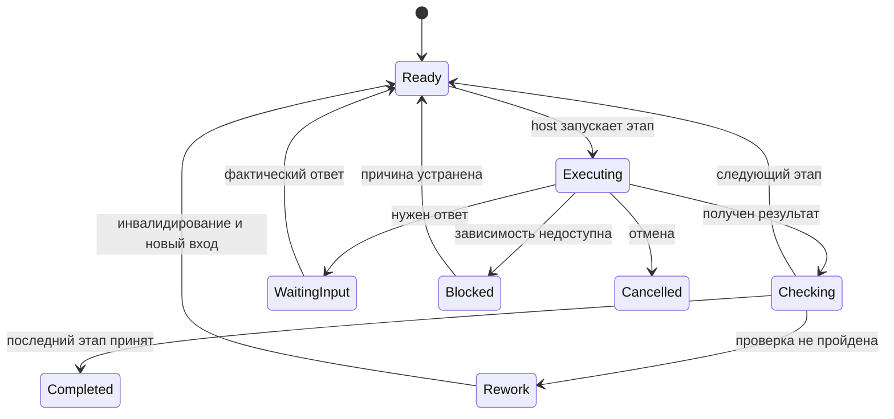

# Архитектура оболочки GigaCode Workbench

Профиль определяет компетенцию и рабочие инструкции. Workflow определяет порядок этапов. Контекст проекта задаёт стек, команды и дизайн-правила. Полномочия определяют разрешённые действия и ресурсы. Эти четыре слоя должны храниться раздельно, чтобы смена профиля не расширяла доступ, а смена модели не меняла критерии готовности.

## Режимы использования

Первый режим уже реализован в пакете: интерактивный GigaCode читает этап, исполняет его существующими инструментами и передаёт результат локальному `workbench.ps1`. Последовательный маршрут, сохранение состояния и проверка комплектности доступны без SDK. Контроль фактических действий остаётся у GigaCode/пользователя.

Второй режим — проект будущей оболочки: backend запускает исполнителей через подтверждённый адаптер GigaCode 26.9.75, наблюдает вызовы инструментов и принимает решения о переходах. Этот транспорт не реализован в пакете: документационный и локальный тест версии на рабочем компьютере предшествует его разработке. Флаги и API upstream Qwen не считаются автоматически доступными.

## Состав приложения

| Компонент | Ответственность |
|---|---|
| Интерфейс задачи | Профиль, сценарий, проект, окружение, текущий этап, вопросы, результаты, история |
| Каталог процессов | Версионированные workflow и правила применимости проверок |
| Хранилище задач | Состояние, решения, артефакты, версии и связи между запусками |
| Сборщик контекста | Только текущая роль, этап и релевантные артефакты; контроль размера контекста |
| Адаптер GigaCode | Запуск/продолжение/отмена и события по подтверждённому контракту конкретной версии |
| Шлюз инструментов | Сопоставление capabilities с реальными tools и полномочиями на ресурсы |
| Проверки переходов | Схема результата, фактические свидетельства, исходники, спецификация и доступность следующего шага |
| Хранилище свидетельств | Исходные результаты tools, логи, скриншоты и hashes с удалением секретов |
| Диспетчер операций | Журнал внешних изменений, неизвестный исход, проверка результата и безопасное продолжение |

В UI пользователь видит действие, результат и причину остановки. Названия MCP-tools, идентификаторы попыток и transport errors доступны в подробностях, но не заменяют объяснение человеческим языком.

## Контракт этапа

Вход: task_id, run_id, workflow_version, stage_id, attempt_id, profile_version, project_id, source_identity, spec_identity, разрешённые ресурсы, входные artifact refs и бюджет.

Выход: status, summary, artifacts, checks, вопросы/блокировки, предложенный возврат, операции и остаточные риски. `completed` от модели — предложение завершения; host независимо проверяет комплектность, происхождение свидетельств и применимые условия. Свидетельство с `unknown`, отсутствующий лог и ошибка инструмента не превращаются в pass.

Исходники идентифицируются commit плюс hash учитываемых незакоммиченных и новых файлов. Спецификация — content hash. Для внешнего приложения/деплоя дополнительно нужны build/image digest и окружение. Один HEAD без состояния рабочей копии недостаточен.

Контекст новой сессии восстанавливается из артефактов и решений. Краткий пересказ чата помогает навигации, но не заменяет утверждённую спецификацию и результаты инструментов.

## Переходы и возвраты

Executing/Checking — состояния будущего host; локальный controller использует более простой автомат из `CONTROLLER.md`. Не подключайте диаграмму как существующий API.

Один владелец записи меняет состояние запуска. Субагенты возвращают результаты; не вызывают submit конкурирующим образом. Для будущего backend используйте optimistic concurrency по revision, идемпотентный request_id и транзакцию записи события/состояния. Локальный lock-файл достаточен только для предоставленного однопроцессного режима на локальном диске.

Изменение требования инвалидирует зависимые артефакты и проверки. Внутри одного запуска reference controller инвалидирует все последующие этапы. В полной оболочке dependency graph позволяет более узкое инвалидирование; между разными запусками оно обязательно должно распространяться по handoff refs.

## Выбор глубины

Мелкая правка использует короткий маршрут с целевой проверкой. Новая функция — discovery/specification по необходимости, затем реализация, интеграция и приёмка. Инцидент начинается с стабилизации и диагностики; полноценное уточнение постоянного изменения выполняется после восстановления.

План до начала исполнения выбирает применимые проверки и объясняет исключения. Нельзя убирать проверку потому, что она уже завершилась неудачно. Для изменения маршрута нужен новый зафиксированный план и сохранение обнаруженных проблем.

## Параллельная работа

После фиксации контракта можно параллельно выполнять backend/frontend, подготовку тестов и документации. Host выделяет отдельные рабочие копии и ownership файлов. Общие контракты имеют владельца и версию. Интеграционный этап проверяет объединённый результат, даже если отдельные ветки были зелёными.

Субагент не обязан быть отдельной моделью. Отдельный контекст помогает ревью, но не доказывает независимость суждения. Детерминированные проверки и реальные пользовательские сценарии остаются необходимыми.

## Подключение проекта

Существующий проект использует свои инструкции, команды и готовую MCP-конфигурацию. Отсутствие файлов Workbench не запускает настройку репозитория: нужные факты сохраняются в контексте задачи. Исследование незнакомого проекта выполняется чтением, при необходимости через discovery.

`onboarding` выбирается только по запросу настройки нового проекта. Это универсальный сценарий без привязки к каталогам, стеку или репозиториям пользователя; правила — в PROJECT_SETUP.md. Он определяет стек, команды проверок и доступные tools, заполняет конфигурацию только проверенными значениями. Не сканирует значения секретов. Ключи capabilities — словарь этого пакета, а не реальные имена MCP.

Git MCP обеспечивает доступные операции с репозиторием/PR, Jenkins — сборки, OpenShift — окружения, Confluence — знания. Sprut проверяет уязвимые версии зависимостей; инструменты чтения отчётов и возможного запуска сканирования определяются по фактическим схемам. Отсутствие нужного browser/test/data/metrics tool даёт конкретную блокировку выбранного этапа.

## Проектирование и качество интерфейса

Используйте `DESIGN_QUALITY.md`: от сценария и информационной иерархии к дизайн-контракту, измерениям, экспертной оценке и регрессии. Внешний вид Zidao не переносится. Числовые пороги имеют источник и область применимости; единый балл качества не вычисляется. Отличайте утверждённую концепцию, реализованное состояние и проверенное состояние.

## Приёмочные сценарии оболочки

1. Перезапуск восстанавливает этап, вопросы и разрешения без повторного запуска внешнего действия.
2. Старый отчёт не может завершить новую попытку, чужой run_id отклоняется.
3. Отсутствующее свидетельство, упавшая проверка и unknown блокируют переход.
4. Изменение спецификации/исходников инвалидирует связанные проверки, включая другой запуск.
5. Ответ пользователя сохраняется с источником и влияет на конкретные требования; выдуманное согласование не принимается.
6. После тайм-аута Jenkins host находит уже созданную сборку вместо повторного старта.
7. PR не создаётся повторно при повторной доставке одного события.
8. Смена профиля не даёт новых полномочий; инструмент для production не доступен в dev-only разрешении.
9. Два исполнителя не повреждают состояние и файлы друг друга; интеграция проверяется отдельно.
10. Отмена не маскирует уже совершённое внешнее действие и не снимает блокировки/лимиты.
11. Frontend не проходит качество по одному desktop screenshot; отчёт показывает выбранную матрицу и фактическое покрытие.
12. Отсутствие пользовательского исследования остаётся unknown; агент не пишет фиктивную успешность задач.

Reference controller покрывает локальную часть этих требований. Транспорт GigaCode, полномочия, внешние операции и межзадачные зависимости требуют интеграционных проверок в вашем окружении.

## Порядок внедрения

Сначала пройдите одну небольшую задачу интерактивно через `/workbench` и сравните артефакты с рабочим процессом. Затем настройте Git/Confluence и локальные проверки. После подтверждения доступов подключите Jenkins/OpenShift и журнал эффектов. Последними добавляйте автоматический транспорт, параллелизм и автоматические внешние записи: им нужны подтверждённые механизмы состояния и разрешений.
